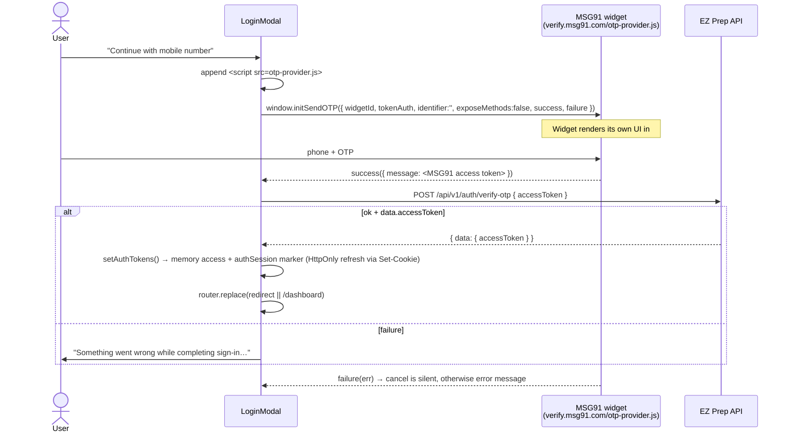

# Existing Web Authentication

This describes how authentication works **today** in the web app. The mobile design is in [`mobile-authentication.md`](mobile-authentication.md).

## 1. Summary

| Aspect | Current behavior | Evidence |
| --- | --- | --- |
| Methods | Google OAuth (authorization code + PKCE) and phone OTP via the MSG91 widget | `lib/googleAuth.ts`, `components/auth/LoginModal.tsx` |
| Session artifact | Bearer **access JWT** (`data.accessToken`, ~15m) plus HttpOnly **refresh cookie** (`ezprep_rt`) for Redis-backed student sessions | `LoginModal.tsx`, `googleAuth.ts`, API auth |
| Storage | Access in **memory** only; refresh never readable by JS; middleware uses non-JWT `authSession=1` marker for **7d** (session length — Edge cannot see the API HttpOnly cookie) | `lib/auth.ts` |
| Refresh | Boot + 401: `POST /auth/refresh` with `credentials: 'include'` (cookie only; single-flight) | `lib/api/client.ts`, `AuthSessionProvider` |
| Expiry | Web session **7d** absolute (refresh cookie); access **15m**; mobile login with `client=mobile` is **90d** | API student sessions |
| Server validation | JWT + Redis `sid` for new student tokens; legacy no-`sid` JWTs until natural expiry; admin unchanged | API `validateJwtPayload` |
| Logout | `POST /auth/logout` with credentials (revokes this `sid`, Clear-Cookie) then clear memory + marker | `lib/auth.ts` `logout()` |
| Route protection | Edge middleware checks session marker presence for `/dashboard`, `/analytics`, `/profile`, `/test` | `middleware.ts` |

See also Phase 12: [`phases/phase-12-session-hardening.md`](phases/phase-12-session-hardening.md).

## 2. Phone OTP flow (MSG91 widget)



Key facts:
- **[Verified]** EZ Prep code never sees the phone number or the OTP. The widget owns phone input, OTP input, length, resend, and rate limiting.
- **[Verified]** The `accessToken` the widget returns is passed to the backend, which **[Inferred]** verifies it with MSG91 server-side (using a private MSG91 auth key that is not in this repo) and then finds or creates the user by phone.
- **[Verified]** `NEXT_PUBLIC_MSG91_WIDGET_ID` and `NEXT_PUBLIC_MSG91_TOKEN_AUTH` are public browser values.
- **[Verified]** There is no first-login branch. New and existing users go straight to the redirect target. `/complete-profile` exists but nothing routes to it.

## 3. Google flow (authorization code + PKCE, browser redirect)

```mermaid
sequenceDiagram
  actor U as User
  participant B as Browser (EZ Prep web)
  participant G as accounts.google.com
  participant API as EZ Prep API

  U->>B: Continue with Google
  B->>B: state=rand(32), verifier=rand(64), challenge=S256(verifier)
  B->>B: sessionStorage: state, verifier, redirectUri, next
  B->>G: location.assign(authorize?client_id&redirect_uri&response_type=code<br/>&scope=openid email profile&state&code_challenge&S256&prompt=select_account)
  G-->>B: redirect to redirect_uri (= "/" origin) ?code&state  (or ?error=access_denied)
  B->>B: app/page.tsx sees ?code → GoogleOAuthReturn
  B->>B: check state === stored state; read verifier, redirectUri
  B->>API: POST /api/v1/auth/google { code, redirectUri, codeVerifier }
  Note over API: [Inferred] exchanges code with Google using<br/>client id + client SECRET + verifier,<br/>validates redirectUri ∈ GOOGLE_REDIRECT_URIS,<br/>finds/creates user, issues app JWT
  API-->>B: { data: { accessToken } }
  B->>B: clear sessionStorage handoff, setAuthTokens (memory), router.replace(next)
```

Key facts:
- **[Verified]** Redirect URIs are `http://localhost:3001` and `https://www.ezprep.in/` (trailing slash). `https://ezprep.in` maps to `https://www.ezprep.in/`. `NEXT_PUBLIC_GOOGLE_REDIRECT_URI` overrides them.
- **[Verified]** A module-level promise (`pendingSession`) makes sure the code is exchanged only once, which protects against React strict-mode double mounts.
- **[Verified]** Error copy: "Google sign-in was cancelled." (access_denied), "Google sign-in could not be verified. Please try again." (state mismatch), "Google sign-in expired. Please try again." (verifier missing), or the API's `message`.
- **[Verified]** The `.env` comment says the client id "must also be listed in the API `GOOGLE_CLIENT_IDS`" (plural), while the README says `GOOGLE_CLIENT_ID`. **[Inferred]** The backend may accept several client ids, which matters for native clients (`U-02`).
- **[Verified]** `GoogleSignInPrompt` on `/` is a custom floating card, not Google One Tap.

## 4. Session lifecycle

| Event | Behavior |
| --- | --- |
| Session creation | `setAuthTokens(access)` → memory + `authSession=1` marker (~access TTL); API sets HttpOnly `ezprep_rt` |
| Session restoration | Full reload: wipe legacy `localStorage` tokens; silent `POST /auth/refresh` with credentials; hydrate memory if cookie valid |
| Authenticated request | Axios `withCredentials` + `Authorization: Bearer <memory access>` |
| 401 from API | Single-flight cookie refresh; on failure `removeAuthToken()` + `/login?redirect=` |
| Marker vs memory | Provider rewrites marker after boot refresh so landing/dashboard drift stays fixed |
| Logout | Saves path to `logoutResumePath`, credentials logout (Clear-Cookie), clear memory + marker, `location.href = '/'` |
| Post-login redirect priority (middleware) | `?redirect` (if safe) → `logoutResumePath` cookie (if safe) → `/dashboard`. The resume cookie is cleared |
| Safe redirect rules | Must start with `/`, must not start with `//`, must not contain `..`, must not be `/`, `/login`, or `/login/*` |

## 5. Guards

| Guard | Scope | Mechanism |
| --- | --- | --- |
| Protected | `/dashboard*`, `/complete-profile*` | middleware: no cookie → `/login?redirect=` |
| Guest-only | `/`, `/login*` | middleware: cookie → redirect target |
| **Unprotected but authenticated content** | `/analytics`, `/profile`, `/study-materials`, `/test` | None (outside the matcher prefixes) |
| Client guard | `ProtectedRoute` component | Unused |

## 6. Web-specific assumptions and what changes on mobile

| Web assumption | Why it breaks on native | Native replacement |
| --- | --- | --- |
| Memory access + HttpOnly refresh cookie | No browser cookies; refresh must live in SecureStore | `expo-secure-store` for refresh; memory access; Phase 12 |
| JS-set `authSession` marker for middleware | No cookies or middleware | Auth state in memory, hydrated from SecureStore at launch; route groups guard navigation |
| `window.location` redirects | No document location | Expo Router `router.replace` |
| MSG91 browser script + DOM mount | No DOM; WebView is a poor fit for auth | MSG91 native/JS SDK, or the EZ Prep backend calling MSG91 send/verify APIs (`U-01`) |
| Google redirect back to `https://www.ezprep.in/` | A native app cannot receive that redirect without App Links. Google restricts custom-scheme redirects for web clients | Native Google Sign-In (Android Credential Manager / Google Identity) returning an ID token or server auth code. **The backend contract likely needs to change** (`U-02`) |
| `sessionStorage` PKCE handoff | Not needed if native SDK is used; otherwise in-memory | In-memory during the auth session |
| `?redirect=` query | No URL bar | An in-memory "pending route" held by the auth layer |
| `logoutResumePath` cookie | No cookie | Optional: remember the last route in non-secure storage, or drop it (`U-15`) |
| `beforeunload` keepalive | No such event | `AppState` change handling (see the attempt phase) |
| Edge middleware checking presence only | — | The mobile app should also only check presence locally. The server stays authoritative through 401s |
