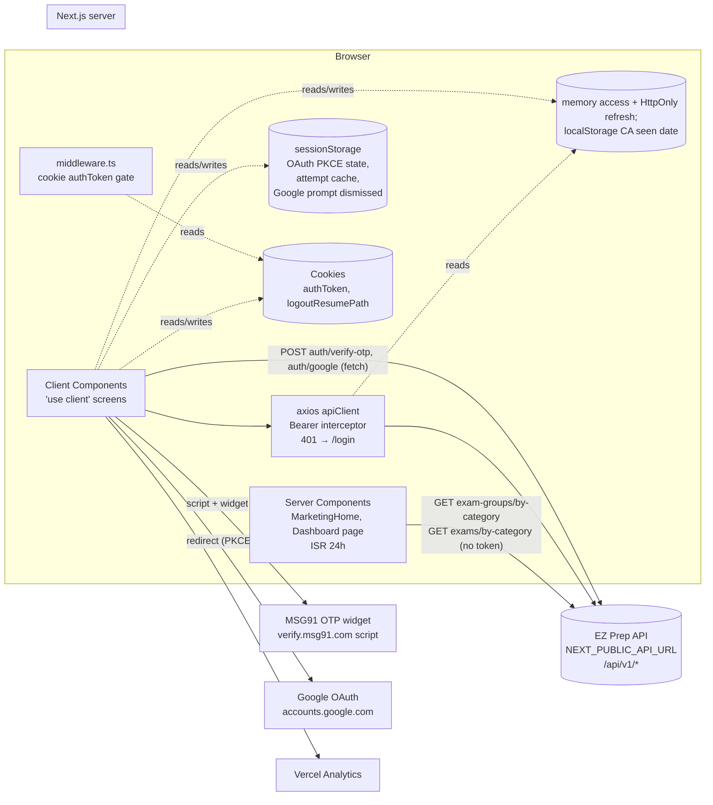
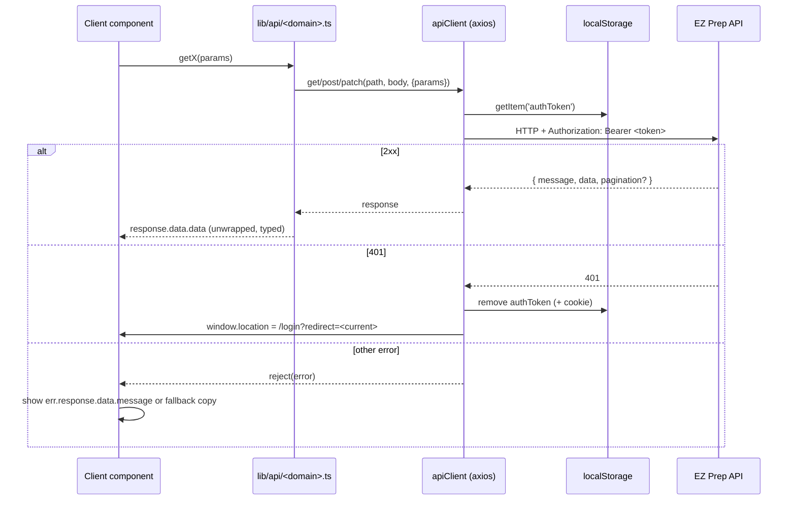

# Existing Web Architecture

## 1. Stack and tooling

| Item | Value | Evidence |
| --- | --- | --- |
| Framework | Next.js **13.5.1**, App Router | [Verified] `package.json`, `app/` directory, no `pages/` |
| React | 18.2.0 | [Verified] `package.json` |
| TypeScript | 5.2.2, `strict: true`, `target: es5`, path alias `@/*` → repo root | [Verified] `tsconfig.json` |
| Node requirement | Not declared (no `engines`, no `.nvmrc`) | [Unknown] |
| Package manager | npm (`package-lock.json`) | [Verified] |
| Styling | Tailwind CSS 3.3.3 + `tailwindcss-animate`, shadcn/ui (`components.json`, style `default`, base color `neutral`, CSS variables) | [Verified] |
| UI primitives | Radix UI via shadcn components in `components/ui/` | [Verified] |
| HTTP | axios 1.x (`lib/api/client.ts`) plus raw `fetch` in auth paths | [Verified] |
| Lint | `next lint`, config `next/core-web-vitals`; `eslint.ignoreDuringBuilds: true` | [Verified] `.eslintrc.json`, `next.config.js` |
| Formatting | No Prettier config | [Verified] absence |
| Tests | **None.** No test runner, no test files | [Verified] absence |
| CI | No `.github/` or other CI config in the repo | [Verified] absence |
| Analytics | `@vercel/analytics` (`<Analytics />` in `app/layout.tsx`) | [Verified] |
| Hosting | Production site `https://www.ezprep.in`. Vercel analytics is present. A comment in `lib/googleAuth.ts` mentions "a droplet", suggesting DigitalOcean for some environments | [Inferred], see `U-14` |
| Scaffold origin | `.bolt/config.json` → template `nextjs-shadcn` (bolt.new scaffold) | [Verified] |

Scripts: `dev`, `build`, `start`, `lint`, `typecheck` (`tsc --noEmit`). The README requires `-p 3001` because the API listens on `3000`.

## 2. Rendering model — what is actually used

| Feature | Used? | Where |
| --- | --- | --- |
| App Router | Yes | All of `app/` |
| Pages Router | No | — |
| Server Components | Yes, a few | `app/page.tsx`, `app/dashboard/page.tsx`, `components/MarketingHome.tsx` (async, fetch on server), legal pages, route wrappers that pass `params` |
| Client Components | Yes, almost all UI | Every interactive component has `'use client'` |
| ISR / revalidate | Yes | `app/page.tsx` and `app/dashboard/page.tsx` export `revalidate = 86400` (24 h) |
| Static generation | Implicit for legal pages | `privacy-policy`, `terms`, `user-policy` |
| SSR with searchParams | Yes | `app/page.tsx` reads `searchParams.code/error` to switch to the Google OAuth return screen |
| Route handlers (`app/api`) | **No** | — |
| Server actions | **No** | — |
| Middleware | Yes | `middleware.ts`: cookie-based route gate |
| Dynamic import | Yes | `next/dynamic` for `AnswerKeyList` (ssr: false) and `import('mathpix-markdown-it')` |
| `next/image` | Yes, `images.unoptimized: true` (no image optimization) | `next.config.js` |
| `next/font` | Inter (Latin subset) | `app/layout.tsx` |
| Redirects | `/terms-of-service` → `/terms` (permanent) | `next.config.js` |

**[Inferred]** The Next.js server mostly serves the frontend. The only server data work is two public catalog fetches (exam groups, exams by category). All user-specific data is fetched client-side with a bearer token from `localStorage`.

## 3. Source structure

```
app/                       routes (thin wrappers around client components)
  page.tsx                 marketing home + Google OAuth return handler
  login/                   marketing home + login modal overlay
  dashboard/               authenticated product (gated by middleware)
    page.tsx               exams by category (server fetch, ISR 24h)
    exam/[id]/             exam hub layout + overview/practice/full-mocks/sprint-tests
    attempt/[attemptId]/   test runner, result
    current-affairs/       daily swipe cards
    profile/               profile + analytics widgets
    courses|concept-videos|bookmarks|subscriptions|search|tests|mentorship|success-stories/  "Coming soon"
  analytics/               AI analytics (DUMMY DATA, not under /dashboard)
  complete-profile/        orphan onboarding form
  profile/                 orphan duplicate of profile without shell
  study-materials/[id]     static mock content
  test/                    legacy demo runner with dummy data
  privacy-policy|terms|user-policy/  legal
components/
  ui/                      shadcn primitives (46 files, ~14 actually imported)
  auth/                    LoginModal (MSG91 + Google), GoogleOAuthReturn, GoogleSignInButton, GoogleSignInPrompt
  dashboard/               DashboardLayout (sidebar + drawer + header), SearchBox, category grid
  exam/                    exam layout/context, hub, test lists, cards, useLaunchAttempt
  attempt/                 AttemptPageClient, MockTestRunner, timer, results, answer key, Mathpix
  profile/                 ProfileView + header/stats/activity/subjects/badges/edit modal
  current-affairs/         view + swipe stack
  analytics/               dummy AI analytics widgets
  study-materials/         static study materials
  test/                    legacy dummy test interface
  legal/                   LegalDocument layout
  (root)                   marketing sections, Header, Footer, AuthModal (dead), ProtectedRoute (unused)
lib/
  api/                     axios client + per-domain API modules with TS types
  auth.ts                  token storage (localStorage + cookie), logout
  googleAuth.ts            Google OAuth PKCE (browser redirect)
  safeRedirect.ts          open-redirect-safe return paths
  attempt-sessions.ts      session/section logic, time-left computation
  attempt-storage.ts       sessionStorage attempt cache
  exam-test-routes.ts      paperType → list route and exit label
  current-affairs-seen.ts  "seen today" flag in localStorage
  mockData.ts              sidebar nav items + legacy mock exam data
  profileData.ts, studyMaterialsData.ts, examMaterialsDetail.ts, dummyTestData.ts  hardcoded content
hooks/                     use-toast (unused), useCurrentAffairsNotification
middleware.ts              auth gate
public/                    3 PNGs (logo, banner, image.png)
```

## 4. Dead, orphaned, and mock code

These matter because the mobile app should **not** blindly reproduce them. Each needs a product decision (`U-08`).

| Item | Status | Evidence |
| --- | --- | --- |
| `components/AuthModal.tsx` | Dead. Simulated OTP with `setTimeout`, never imported | [Verified] grep |
| `components/ProtectedRoute.tsx` | Unused | [Verified] grep |
| `lib/auth.ts` `makeAuthenticatedRequest`, `decodeToken`, `isTokenExpired` | Unused. `decodeToken` base64-decodes the whole token, which would not work on a real JWT | [Verified] |
| `lib/googleAuth.ts` `isGoogleSignInConfigured` | Unused. The README says an empty client id hides Google sign-in, but `LoginModal` always renders the Google button | [Verified] |
| `app/complete-profile` | Not linked from anywhere. Posts to `/api/v1/user/complete-profile` (singular `user`), which differs from the `/api/v1/users/me` used elsewhere | [Verified]; endpoint existence `U-09` |
| `app/profile` | Duplicate of `/dashboard/profile` without the shell. Not linked. Not protected by middleware | [Verified] |
| `app/analytics` | Renders `lib/profileData.ts` **dummy data** ("AI Analytics"). Linked only from `ProfileSubjects` ("View analytics"). Not protected by middleware | [Verified] |
| `app/study-materials/*` | Static hardcoded content. Not linked from the app shell | [Verified] |
| `app/test` | Legacy demo runner with `lib/dummyTestData.ts` | [Verified] |
| 8 "Coming soon" routes | Courses, Concept Videos, Bookmarks, Subscriptions (in sidebar). Search, Tests, Mentorship, Success Stories (not in sidebar) | [Verified] |
| `hooks/use-toast.ts`, most `components/ui/*` | Not imported by feature code | [Verified] |
| `google-auth-library`, `@supabase/supabase-js` | Declared, never imported | [Verified] |

## 5. Architecture diagram — existing web



## 6. Frontend → API data flow



Component-local `useState`/`useEffect` handles fetching. There is no shared cache, no retry, and no request deduplication.
