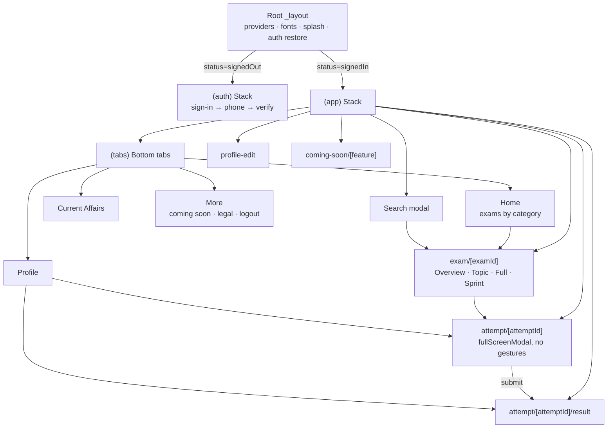
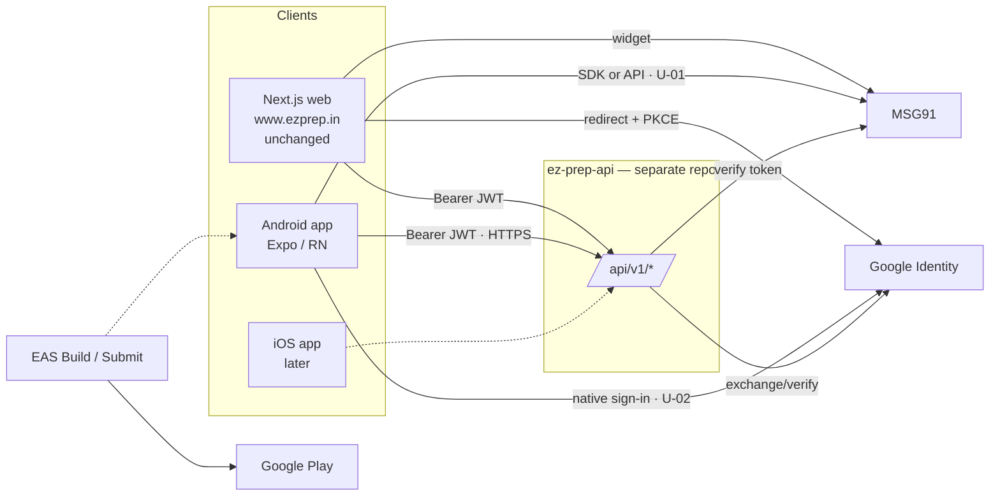

# Target Mobile Architecture

Status: **proposal**. Decisions marked *(decide in phase NN)* are confirmed during that phase.

## 1. Principles
- A native app with the same product behavior as the web app. Not a port of web components.
- Expo managed workflow with **development builds** (Expo Go is not enough once native Google sign-in or another native module is added).
- Android first. iOS must stay buildable in principle: no Android-only architecture, and platform code isolated in `*.android.ts` / `*.ios.ts` or `Platform.select`.
- Minimal dependencies (see [`package-strategy.md`](package-strategy.md)).
- The server is authoritative for auth, time, attempt status, and scoring.

## 2. Repository

**Recommendation:** a **separate repository** (e.g. `ezprep-mobile`). The web repo must stay unchanged, and the Expo toolchain (Metro, EAS, native config) should not mix with Next.js. *(Confirm: `U-26`.)* These docs can be copied into the mobile repo's `docs/` or referenced from here.

## 3. Folder structure

```
app/                              Expo Router routes ONLY (thin screens: compose features, no API calls)
  _layout.tsx                     Root: providers (SafeArea, GestureHandler, QueryClient, Auth, Theme), font loading, splash
  +not-found.tsx
  (auth)/                         Guest-only group
    _layout.tsx
    sign-in.tsx                   Google + "Continue with mobile number"
    phone.tsx                     Phone entry   (if EZ Prep renders its own OTP UI — phase 01)
    verify.tsx                    OTP entry
  (app)/                          Signed-in group (guarded)
    _layout.tsx                   Stack
    (tabs)/
      _layout.tsx                 Bottom tabs: Home · Current Affairs · Profile · More
      index.tsx                   Home: exams by category
      current-affairs.tsx
      profile.tsx
      more.tsx                    Coming-soon entries, legal links, app version, logout
    search.tsx                    Global search (modal presentation)
    exam/[examId]/
      _layout.tsx                 Exam header + segmented tabs (Overview · Topic Wise · Full Mocks · Sprint)
      index.tsx                   Overview
      practice.tsx
      full-mocks.tsx
      sprint-tests.tsx
    attempt/[attemptId]/
      index.tsx                   Runner (fullScreenModal, gestures disabled)
      result.tsx
    profile-edit.tsx
    coming-soon/[feature].tsx

src/
  components/                     Reusable, feature-agnostic UI primitives (no API, no business rules)
    ui/                           Button, Text, Card, Badge, TextField, Screen, Sheet, ConfirmDialog,
                                  EmptyState, ErrorState, LoadingState, Skeleton, ProgressBar, InlineAlert
  features/                       One folder per product domain; owns its screens' building blocks
    auth/        components/ hooks/ api/ model/        (AuthProvider, useAuth, sign-in flows)
    catalog/     components/ hooks/ api/               (exams by category, exam detail, search)
    tests/       components/ hooks/ api/ model/        (test lists, TestActionButton, useLaunchAttempt)
    attempt/     components/ hooks/ api/ model/        (runner state machine, timer, palette, sessions)
    results/     components/ hooks/ model/             (score ring, section breakdown, answer key)
    content/     components/                           (QuestionContent: math + images + language)
    profile/     components/ hooks/ api/               (profile, stats, activity, subjects, badges, edit)
    current-affairs/ components/ hooks/ api/ model/    (swipe stack, date nav, seen badge)
  api/                            Transport only: http client, error normalisation, query client config
    http.ts  errors.ts  queryClient.ts  envelope.ts
  services/                       Cross-cutting device services: secureStorage, kvStorage, logger, linking, appState
  hooks/                          Generic hooks only (useDebouncedValue, useAppState, useRefreshOnFocus)
  stores/                         Global client state, kept to a minimum: auth context, CA-seen context
  types/                          Shared API model types (inferred from zod schemas) and navigation types
  utils/                          Pure helpers (formatDuration, dateKey, safeRedirect, scoreColor)
  constants/                      Static constants (paper types, labels, page sizes)
  config/                         env.ts (validated EXPO_PUBLIC_* access), app constants
  theme/                          tokens: colors, typography, spacing, radius, elevation
```

### What belongs where

| Layer | Contains | Must not contain |
| --- | --- | --- |
| `app/` | Route files, screen composition, navigation options, param parsing | `fetch`, business rules, styling systems |
| `src/components/ui` | Generic, accessible primitives styled by theme tokens | Feature knowledge, API calls |
| `src/features/<x>/components` | Feature UI (e.g. `PracticeTestCard`) | Direct HTTP calls (use the feature hooks) |
| `src/features/<x>/hooks` | `useQuery`/`useMutation` wrappers, feature logic hooks | JSX |
| `src/features/<x>/api` | Endpoint functions + zod schemas for that domain | UI, navigation |
| `src/features/<x>/model` | Pure logic: reducers, selectors, mappers (port of `lib/attempt-sessions.ts`, `lib/exam-test-routes.ts`) | React, I/O |
| `src/api` | One HTTP client: base URL, timeout, auth header, 401 hook, envelope unwrap, error normalisation | Endpoint knowledge |
| `src/services` | Wrappers around device APIs so features never import Expo modules directly | UI |
| `src/stores` | Only truly global client state | Server data (that lives in the query cache) |
| `src/config` | Validated env access; throws at startup if required vars are missing | Secrets |
| `src/theme` | Design tokens from `design-system.md` | Components |

## 4. Navigation



- **Guarding:** use Expo Router's protected-route support (`Stack.Protected` / guard) if the chosen SDK provides it. Otherwise use `<Redirect>` in group layouts based on `useAuth().status`. While `status === 'restoring'`, keep the splash visible.
- **Runner presentation:** `presentation: 'fullScreenModal'`, `gestureEnabled: false`, the header hidden (custom header). `usePreventRemove` + `BackHandler` show the leave dialog.
- **After submit:** the web shows results **in place**. On mobile, `router.replace('/attempt/[id]/result')` with the submit response seeded into the cache. Back from results then cannot return to a finished runner. Same intent, better native stack hygiene.
- **Exam tabs:** a segmented control in `exam/[examId]/_layout.tsx` that switches child routes *(decide in phase 04: custom tab bar via Expo Router `Tabs` with a top-positioned `tabBar`, or `@react-navigation/material-top-tabs`, which adds a pager dependency)*.

## 5. Data layer

```mermaid
flowchart LR
  subgraph UI
    S[Screen] --> FC[Feature component]
  end
  FC --> FH[Feature hook]
  FH --> Q[(TanStack Query cache)]
  Q --> FA[Feature api fn + zod]
  FA --> H[src/api/http.ts]
  H --> T[(SecureStore token via services/secureStorage)]
  H -->|HTTPS| API[(EZ Prep API)]
  H -- 401 --> AUTHC[Auth context: signOut → clear cache → (auth)]
```

- `http.ts`: `fetch` with an AbortController timeout (default 15 s; longer for `submit`/`sessions/complete`, `U-27`), JSON, `Authorization` header from the in-memory token. Envelope unwrap (`data`, tolerate unwrapped like `submitAttempt`). Normalised `ApiError { status, message, code? }` where `message` comes from the body `message` when it is a string.
- Retries: GET 1–2× with backoff on network/5xx. **No retry** on non-idempotent POSTs.
- Query keys: `['catalog']`, `['exam', id]`, `['tests', type, examId, filters]`, `['attempt', id]`, `['me']`, `['analytics', kind, params]`, `['currentAffairs', dateKey]`, `['search', q]`.
- Invalidation: after an attempt submits or pauses, invalidate `['tests', *, examId]` and `['analytics']`.

## 6. Ecosystem



## 7. Cross-cutting concerns

| Concern | Approach |
| --- | --- |
| Environment | `app.config.ts` reads `APP_VARIANT` (`development` / `preview` / `production`) → different package suffix, name, and API URL. `src/config/env.ts` validates `EXPO_PUBLIC_*` with zod at startup |
| Logging | `services/logger.ts`: `debug/info/warn/error`. No-op `debug` in release. Redacts `authorization`, `accessToken`, `token`, `otp`, `phone`. Crash reporting vendor TBD (`U-16`) |
| Error handling | `ErrorBoundary` at the root and per screen. A query error → `ErrorState` with Retry. A mutation error → inline message using the API `message` when present (parity with web copy) |
| App state | `services/appState.ts` exposes foreground/background events for the runner and query `focusManager` |
| Connectivity | Query `onlineManager` with `@react-native-community/netinfo` *(optional; decide in phase 06 for the runner's offline messaging)* |
| Theming | `theme/` tokens. Light only. No styling library |
| i18n | UI chrome is English, matching web. Question content toggles EN/ML per exam. No i18n framework needed now |
