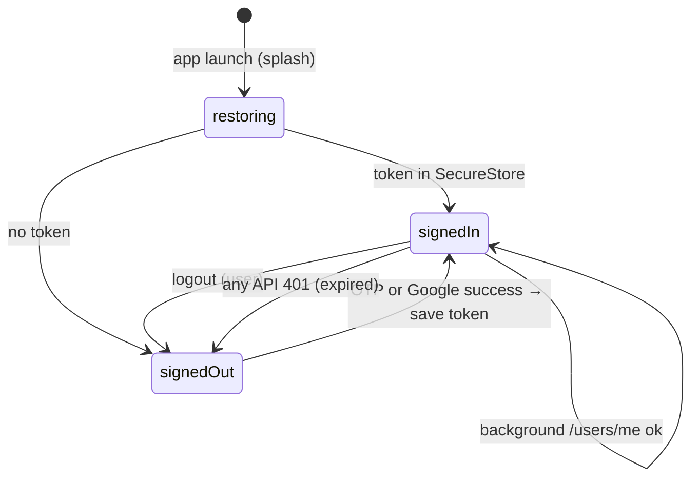
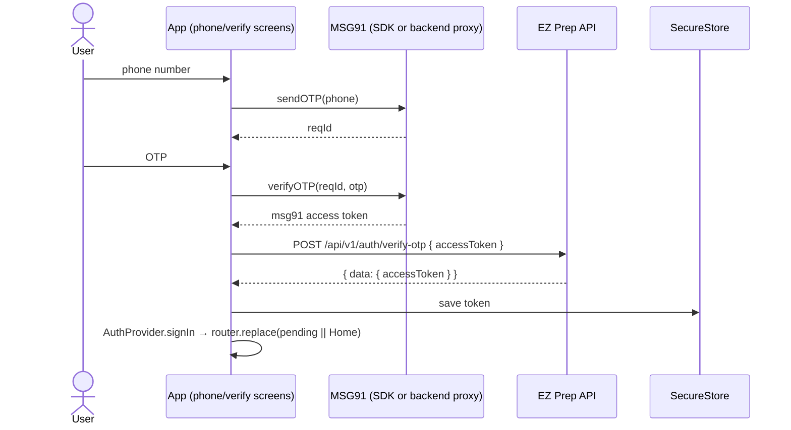
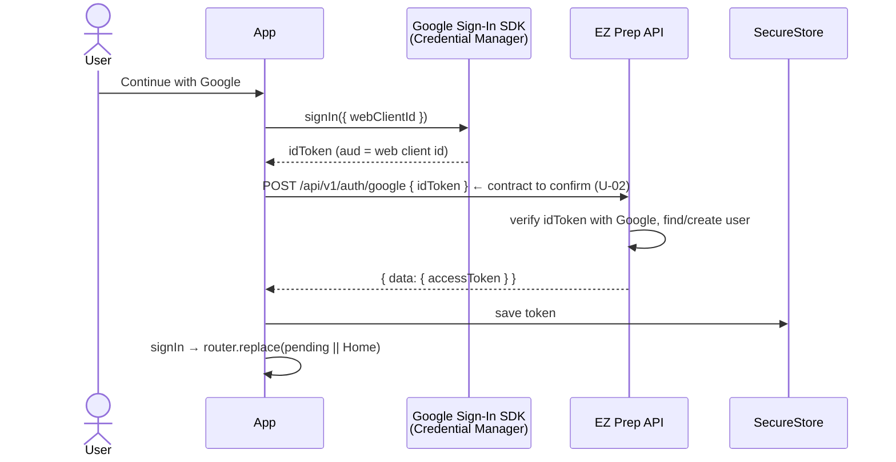

# Mobile Authentication Architecture

Read [`authentication.md`](authentication.md) first for how the web works today.

## 1. Goals
- The same two sign-in methods as the web: **phone OTP** and **Google**.
- The same session artifact: the EZ Prep API access token (`data.accessToken`), sent as `Authorization: Bearer`.
- No secrets in the app. No WebView-based auth.
- If the backend must change for native Google sign-in, that change is documented and agreed, never assumed.

## 2. Session management

| Concern | Design |
| --- | --- |
| Storage | `expo-secure-store`: `ezprep.auth.token` (access) and, after Phase 12, `ezprep.auth.refresh`. `keychainAccessible: AFTER_FIRST_UNLOCK` |
| In-memory state | `AuthProvider` context: `{ status: 'restoring' \| 'signedOut' \| 'signedIn', token?: string, signIn(...), signOut(reason?) }`. `http.ts` reads the token from the provider, not SecureStore, on each request |
| Restoration at launch | Keep the splash → read SecureStore → `signedIn` if a token is present, otherwise `signedOut` → hide the splash. Then, in the background, call `GET /api/v1/users/me` (seeds the `['me']` cache). A 401 triggers refresh (Phase 12) or sign-out |
| Refresh | Backend supports `refreshToken` with **90d sliding** idle for `client=mobile`. **Phase 12** wires SecureStore + single-flight `POST /auth/refresh`. Until then, pass `client: 'mobile'` so access alone lasts ~90d |
| 401 handling | Phase 01: 401 → `signOut('expired')`. Phase 12: 401 → one refresh attempt → retry; else sign-out with "Your session has expired…" |
| Logout | Phase 12: `POST /auth/logout` (revokes this device only) then clear SecureStore + Google SDK `signOut()`. Web logout does not affect mobile |
| Route protection | Expo Router groups: `(auth)` only when `signedOut`, `(app)` only when `signedIn`. Guard at the layout level |
| Pending route (deep link while signed out) | Store an in-memory target. After `signIn`, `router.replace(target)` if `isSafeInAppPath(target)` (port the rules from `lib/safeRedirect.ts`), else Home |
| Resume after logout | Web remembers the last path for 7 days. On mobile this is low value *(drop unless product asks; `U-15`)* |
| First-login / onboarding | None today (verified). Do not add one |

## 3. Phone OTP

### Constraint
The web uses the MSG91 **browser widget** (`otp-provider.js` + `window.initSendOTP`), which renders DOM UI. It cannot run in React Native.

### Options

| Option | How | Backend change? | Pros | Cons |
| --- | --- | --- | --- | --- |
| **A. MSG91 mobile SDK** (recommended to evaluate first) | MSG91 publishes mobile SDKs for its OTP widget (a React Native package is advertised in MSG91 docs). The app renders its own phone + OTP screens and calls SDK `sendOTP` / `verifyOTP` with the same `widgetId` + `tokenAuth`. On success the SDK yields the same kind of access token → existing `POST /auth/verify-otp { accessToken }` | **Likely none** | Reuses the backend contract and MSG91 config | The package name, maintenance, Expo compatibility (dev build needed?), captcha behavior, and widget mobile settings all need verification (`U-01`) |
| B. MSG91 REST through the backend | New backend endpoints `POST /auth/otp/send { phone }` and `POST /auth/otp/verify { phone, otp }` that call MSG91 server-side with the private auth key | **Yes** | Most control. No third-party SDK in the app | Backend work. The backend owns rate limiting and abuse protection |
| C. Host the widget in a WebView | Load the MSG91 script in a WebView and post the token back | No | Fast to prototype | **Rejected**: violates the "no WebView auth shortcuts" rule; fragile; poor UX/a11y |

**Decision gate (phase 01):** Spike option A on the physical Android device. If it works with the existing widget configuration, use it. Otherwise request option B from the backend team.

### UX (native, owned by EZ Prep)
1. **Phone screen:** a `+91` prefix (web is India-only by widget config, **[Inferred]**; `U-28`), a 10-digit numeric field (`keyboardType="phone-pad"`, `autoComplete="tel"`), the "Send OTP" button disabled until 10 digits, and the Terms/Privacy notice: "By continuing, you agree to our Terms and Privacy Policy" (links open in an in-app browser).
2. **OTP screen:** "We sent a code to +91 XXXXXXXXXX", an OTP field (`autoComplete="sms-otp"`, `textContentType="oneTimeCode"`; digit count from MSG91 config, `U-28`), "Verify & Continue", a resend button with a countdown, and "Change number".
3. **Verifying:** a full-screen "Verifying your account..." (same copy as web).
4. **Errors:** use the web copy ("Could not verify" + message; "Something went wrong while completing sign-in. Please try verifying again in a moment."). Cancel is silent.
5. **SMS autofill:** Android SMS User Consent or SMS Retriever is optional. Retriever needs an app hash in the SMS template, which is an MSG91 template change (`U-28`).

## 4. Google sign-in

### Constraint
The backend endpoint `POST /api/v1/auth/google` takes `{ code, redirectUri, codeVerifier }`. **[Inferred]** It exchanges a **web** authorization code with the web client secret and validates `redirectUri` against `GOOGLE_REDIRECT_URIS` (`https://www.ezprep.in/`, `http://localhost:3001`). A native app cannot cleanly receive a redirect to those web URLs.

### Options

| Option | How | Backend change? | Notes |
| --- | --- | --- | --- |
| **A. Native Google Sign-In + ID token** (recommended) | `@react-native-google-signin/google-signin` (Credential Manager on Android) configured with `webClientId` = the existing web client id. Returns an **ID token** whose `aud` is the web client id. The app sends it to a new or extended endpoint, e.g. `POST /auth/google { idToken }`. The backend verifies it with Google (`verifyIdToken`, audience = web client id) | **Yes**: accept `idToken` | Standard, best UX (account picker sheet). Needs an Android OAuth client in Google Cloud (package name + SHA-1 of the debug keystore, EAS upload key, and Play app-signing key). The `.env` mentions `GOOGLE_CLIENT_IDS` (plural), so the backend may already accept several audiences (`U-02`) |
| A′. Native sign-in + server auth code | The same SDK with `offlineAccess` returns `serverAuthCode`. The backend exchanges it with the web client secret **without** PKCE and with an empty or `postmessage` redirect | **Yes**: accept the code without verifier/redirect | Only if the backend needs Google API access later. Otherwise A is simpler |
| B. System browser (`expo-auth-session` + `expo-web-browser`) with the existing web client | Redirect to `https://www.ezprep.in/...`, captured via Android App Links | Backend: add a redirect URI. **Web:** host `assetlinks.json` and a handler route | Touches web hosting. App Links verification is fragile. Not recommended |
| C. WebView OAuth | — | — | **Rejected**: Google blocks OAuth in embedded WebViews |

**Decision gate (phase 01):** Confirm the backend contract (`U-02`) before implementing Google. Phone OTP does not depend on this and can ship first.

### UX
- A "Continue with Google" button with the Google mark (branding guidelines). Pending label "Opening Google…".
- Cancel → no error (web shows "Google sign-in was cancelled." only on the redirect path; native cancel should be silent).
- Failure → "Google sign-in could not be completed. Please try again." or the API `message`.
- Hide the Google button if `EXPO_PUBLIC_GOOGLE_WEB_CLIENT_ID` is empty. This matches the README's stated intent. Note that the current web code does not actually hide it.

## 5. Deep links
- Scheme: `ezprep://` (proposed, `U-29`). Used for internal links and future notifications. **Not** used for OAuth with option A.
- Android App Links for `https://www.ezprep.in/*` are out of scope (they would require web-hosted `assetlinks.json`).

## 6. Error cases

| Case | Behavior |
| --- | --- |
| No network on sign-in | Inline "Check your connection and try again." Keep the entered phone number |
| MSG91 send failure / rate limit | Show the provider message if user-safe, otherwise a generic error |
| Wrong OTP | "That code didn't match or something went wrong. Please try again." (web copy) |
| Backend verify fails | "Something went wrong while completing sign-in. Please try verifying again in a moment." |
| Google Play Services missing/outdated | Show the SDK's resolution prompt. Fall back to phone OTP |
| Token expired during use | 401 → signed out with a message, return to the pending route after re-auth |
| Token storage unavailable (SecureStore throws) | Treat as signed out, log a non-PII warning |
| Double-tap on Verify/Google | Buttons disabled while in flight. Single in-flight promise (parity with `pendingSession`) |

## 7. Configuration

| Variable | Client-safe | Purpose |
| --- | --- | --- |
| `EXPO_PUBLIC_API_URL` | ✅ | API origin (no `/api/v1`) |
| `EXPO_PUBLIC_MSG91_WIDGET_ID` | ✅ | MSG91 widget (option A) |
| `EXPO_PUBLIC_MSG91_TOKEN_AUTH` | ✅ (public on web too) | MSG91 widget token |
| `EXPO_PUBLIC_GOOGLE_WEB_CLIENT_ID` | ✅ | `webClientId` for ID tokens |
| Google Android client | n/a in code | Registered in Google Cloud by package + SHA-1 |
| Google client **secret**, MSG91 **auth key**, JWT secret | ❌ | Backend only. Never in the app or EAS public env |
