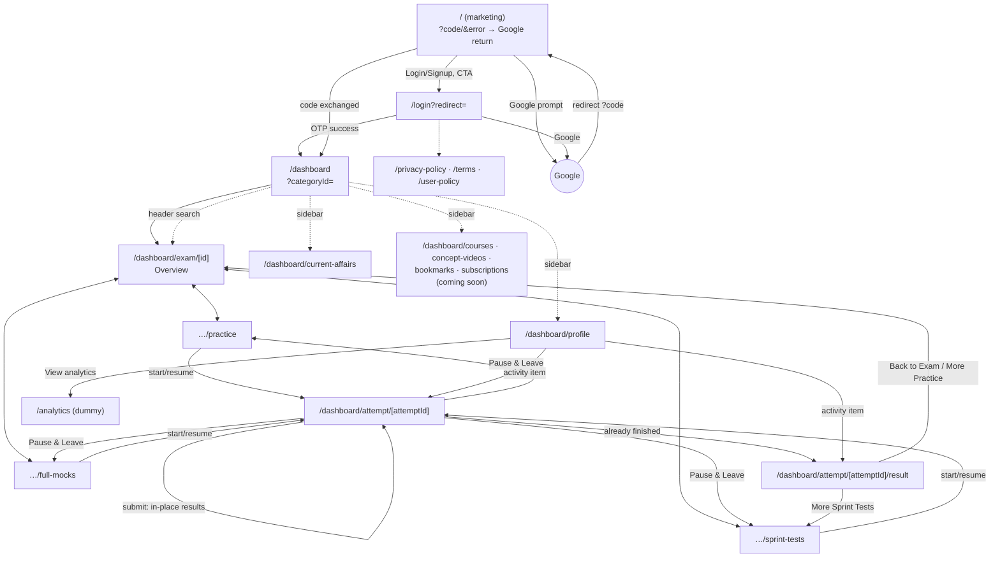
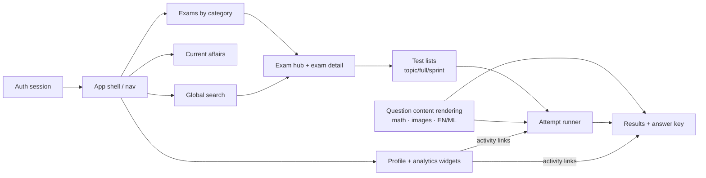

# Navigation Map and User Journeys

## 1. Primary user journeys (from actual code)

### J1 — First sign-in
`/` (marketing) → "Login / Signup" or Google prompt → `/login` → Google **or** mobile OTP → `POST auth/*` → token saved → `redirect` param (default `/dashboard`).

### J2 — Deep link while signed out
Any `/dashboard/...?x` → middleware → `/login?redirect=/dashboard/...?x` → sign in → back to the original path.

### J3 — Practice a topic
`/dashboard` → exam card → `/dashboard/exam/{id}` (Overview) → "Topic Wise" → search/filter → **Start Practice** → `POST start` → `/dashboard/attempt/{attemptId}` → answer → Submit → **results render in place** (URL unchanged) → "More Practice Tests" → `/dashboard/exam/{id}`.

### J4 — Full mock, session-wise
Exam → "Full Mocks" → **Start Mock** → runner, section 1 → "Next Section" → confirm (no return) → `sessions/complete` → section 2 … → last section "Submit Test" → results in place.

### J5 — Pause and resume later
Runner → Pause (palette) **or** back button → "Leave the exam?" → **Pause & Leave** → list page for that paper type → card now shows **Resume** → `GET resume` → runner restores answers.
Alternative: Profile → Recent activity (status Paused) → `/dashboard/attempt/{id}` → loads paused → Resume.

### J6 — Review a past result
Profile → Recent activity (Submitted/Expired) → `/dashboard/attempt/{id}/result`.
Or open `/dashboard/attempt/{id}` for a finished attempt → auto-redirect to `/result`.

### J7 — Daily current affairs
Sidebar "Current Affairs" (red dot if not seen today) → swipe cards → finish → optional date navigation.

### J8 — Search
Header search (debounced 320 ms) → category result → `/dashboard?categoryId=` (scroll) or exam result → `/dashboard/exam/{id}`.

### J9 — Profile management
Sidebar "My Profile" → view stats/activity/subjects/badges → Edit → PATCH → updated header.

### J10 — Logout
Sidebar or marketing header "Logout" → stores the current path in the `logoutResumePath` cookie (7 d) → clears the token → `/`. On the next sign-in, middleware sends the user back to that path.

## 2. Existing route structure

## 3. Dependency graph (what each screen needs before it can work)

## 4. Deep-link implications for mobile

| Web URL | Proposed native route | Notes |
| --- | --- | --- |
| `/dashboard` | `ezprep:///(app)/(tabs)/home` | Default after sign-in |
| `/dashboard/exam/{id}` | `/(app)/exam/[examId]` | Needs auth |
| `/dashboard/exam/{id}/practice` etc. | `/(app)/exam/[examId]/practice` … | |
| `/dashboard/attempt/{id}` | `/(app)/attempt/[attemptId]` | Must load server state and never trust deep-link params alone |
| `/dashboard/attempt/{id}/result` | `/(app)/attempt/[attemptId]/result` | |
| `/dashboard/current-affairs` | `/(app)/(tabs)/current-affairs` | Candidate for notification deep link later |
| `/` with `?code=` | **Not applicable** | Google return is not a web redirect on native (see `mobile-authentication.md`) |

Android App Links / iOS Universal Links for `https://www.ezprep.in/dashboard/...` are **out of scope** until later (`U-13`). They need `assetlinks.json` / `apple-app-site-association` hosted on the web domain, which would be a change to web hosting.

The `redirect` return-path concept stays: if a deep link arrives while signed out, store the target in memory, show sign-in, then navigate. Use the same safety rules as `lib/safeRedirect.ts`: in-app paths only, and never the sign-in route itself.
