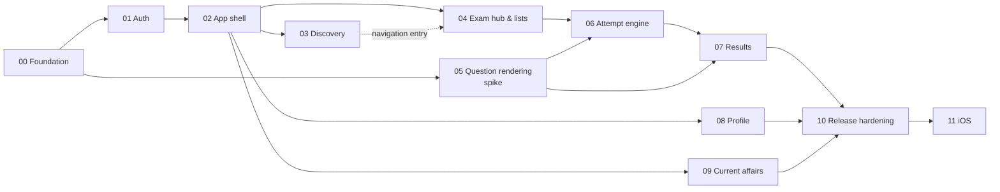

# Implementation Phases

Each phase is independently executable in a fresh session and ends in a working, testable app on the physical Android device.

## Execution model (every session)
1. Read [`../engineering-rules.md`](../engineering-rules.md) (global project rules).
2. Read [`../MOBILE_STATUS.md`](../MOBILE_STATUS.md).
3. Read the phase file.
4. Read only the web source files the phase file lists.
5. Implement only that phase.
6. Validate: typecheck, lint, tests, and the device checklist.
7. Update `MOBILE_STATUS.md`.

## Phases

| # | Phase | Objective | Key blockers |
| --- | --- | --- | --- |
| 00 | [Foundation](phase-00-foundation.md) | Expo project, tooling, theme, HTTP client, env, CI, dev build on the device | U-26, U-29 |
| 01 | [Authentication](phase-01-authentication.md) | Phone OTP + Google sign-in, secure session, guards, logout | U-01, U-02, U-28, U-30 |
| 02 | [App shell & navigation](phase-02-app-shell.md) | Tabs, More, coming-soon, legal links, error/empty primitives | U-08, U-12 |
| 03 | [Home & exam discovery](phase-03-home-discovery.md) | Exams by category, search | U-05, U-07, U-20 |
| 04 | [Exam hub & test lists](phase-04-exam-hub-test-lists.md) | Overview, topic-wise, full mocks, sprint lists, start/resume/retake launch | — |
| 05 | [Question content rendering](phase-05-question-rendering.md) | Math/markdown/image/EN-ML rendering component (spike → production) | U-31, U-18 |
| 06 | [Attempt engine](phase-06-attempt-engine.md) | Runner: timer, answers, palette, sessions, pause/leave, submit | U-03, U-17, U-27 |
| 07 | [Results & answer key](phase-07-results.md) | Score, sections, answer key | U-11 |
| 08 | [Profile](phase-08-profile.md) | Profile, stats, activity, subjects, badges, edit | — |
| 09 | [Current affairs](phase-09-current-affairs.md) | Daily swipe stack, date navigation, new badge, image share | — |
| 10 | [Release hardening & Play Store](phase-10-release-hardening.md) | Security, performance, a11y passes, crash reporting, store listing, internal → production | U-06, U-16, U-23, U-24, U-32 |
| 11 | [iOS enablement](phase-11-ios-enablement.md) | iOS build, Google iOS client, App Store | U-33 |

**Deferred (not phased):** AI Analytics (mock today), Study Materials (static today), Mentorship/Courses/Bookmarks/Concept videos/Subscriptions/Success stories/Tests hub (coming soon on web), marketing home. All of them depend on U-08.

## Dependency graph

## Recommended order
`00 → 01 → 02 → 03 → 04 → 05 → 06 → 07 → 08 → 09 → 10 → 11`

## What can run in parallel
- **Phase 05 spike** (renderer choice with fixture content) can start right after 00, in parallel with 01–04. Its integration and acceptance with live attempt data need 04.
- **Phases 08 and 09** depend only on 02. They can be built in parallel with 03–07 by another developer.
- **Phase 03 and 04** share only the exam-card → exam-hub link. 04 can be developed with a deep link (`/exam/<id>`) while 03 is in progress.
- **Backend asks** (U-01, U-02, U-04, U-06, U-32) should be raised during phase 00 so they're answered before they block.

## Status
See [`../MOBILE_STATUS.md`](../MOBILE_STATUS.md). This file only defines the plan.
