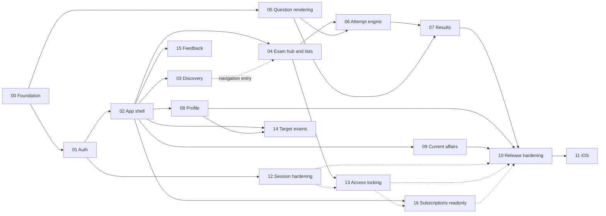

# Implementation Phases

Each phase is independently executable in a fresh session and ends in a working, testable app on the physical Android device.

## Execution model (every session)
1. Read [`../engineering-rules.md`](../engineering-rules.md) (global project rules).
2. Read the authoritative status file: [`../../../../ez-prep-mobile/MOBILE_STATUS.md`](../../../../ez-prep-mobile/MOBILE_STATUS.md) (or the mobile repo root `MOBILE_STATUS.md` when the session’s cwd is that repo).
3. Read the phase file.
4. Read only the web/API source files the phase file lists (web and API stay read-only unless the phase explicitly requires an API owner follow-up).
5. Implement only that phase.
6. Validate: typecheck, lint, tests, and the device checklist.
7. Update `ez-prep-mobile/MOBILE_STATUS.md`.

## Phases

| # | Phase | Objective | Key blockers |
| --- | --- | --- | --- |
| 00 | [Foundation](phase-00-foundation.md) | Expo project, tooling, theme, HTTP client, env, CI, dev build on the device | U-26, U-29 |
| 01 | [Authentication](phase-01-authentication.md) | Phone OTP + Google sign-in, secure session, guards, logout | U-01, U-02, U-28, U-30 |
| 02 | [App shell & navigation](phase-02-app-shell.md) | Tabs, More, coming-soon, legal links, error/empty primitives | U-08, U-12 |
| 03 | [Home & exam discovery](phase-03-home-discovery.md) | Exams by category, search | U-05, U-07, U-20 |
| 04 | [Exam hub & test lists](phase-04-exam-hub-test-lists.md) | Overview, topic-wise, full mocks, sprint lists, start/resume/retake launch | — |
| 05 | [Question content rendering](phase-05-question-rendering.md) | Math/markdown/image/EN-ML rendering component (spike → production) | U-31, U-18 |
| 06 | [Attempt engine](phase-06-attempt-engine.md) | Runner: timer, answers, palette, sessions, pause/leave, submit | U-03, U-17, U-27 |
| 07 | [Results & answer key](phase-07-results.md) | Score, sections, answer key | U-11 |
| 08 | [Profile](phase-08-profile.md) | Profile, stats, activity, subjects, badges, edit | — |
| 09 | [Current affairs](phase-09-current-affairs.md) | Daily swipe stack, date navigation, new badge, image share | — |
| 10 | [Release hardening & Play Store](phase-10-release-hardening.md) | Security, performance, a11y passes, crash reporting, store listing, internal → production | U-06, U-16, U-23, U-24, U-32 |
| 11 | [iOS enablement](phase-11-ios-enablement.md) | iOS build, Google iOS client, App Store | U-33 |
| 12 | [Session hardening](phase-12-session-hardening.md) | Redis sessions, refresh token, per-device logout, `client=mobile` (**P0** — OTP currently gets web 15m TTL) | Phase 01; backend already shipped |
| 13 | [Access locking](phase-13-access-locking.md) | Paper `access` fields, Locked badge, website-only purchase message, refetch unlock | Phase 04; Phase 12 recommended |
| 14 | [Multi-target exams](phase-14-target-exams.md) | Up to 5 ordered targets: Home, exam star, results prompt, profile chips | Phase 02/08 |
| 15 | [Support & feedback](phase-15-support-feedback.md) | More: mailto + `POST /feedback` | Phase 02 |
| 16 | [Subscriptions read-only](phase-16-subscriptions-readonly.md) | My Subscriptions (entitlements/orders/invoices); remove dead coming-soon entries | Phase 02; Phase 13 recommended |

**Deferred (not phased):** AI Analytics (mock on web), Study Materials (static), Mentorship / Success stories / Tests hub (still absent on web), marketing home, **in-app checkout / Razorpay** (owner decision: purchase on website only; see U-Purchase). Native mobile checkout remains out of scope until product revisits Play Billing vs Razorpay.

## Dependency graph

## Recommended order

**Completed through 09** on mobile (see status). Next:

`12 → 13 → 16`, with **14** and **15** in parallel after 02/08 whenever capacity allows, then resume **10** (Play release), then **11** (iOS).

Phases **12–16 need no new native modules** — ship via EAS Update on the existing development runtime. The next EAS binary is for unfinished Phase 10 splash/Sentry native bits only. Do **not** install Razorpay or IAP packages for these phases.

## What can run in parallel
- **Phase 05 spike** (historical) could start after 00; already done.
- **Phases 08 and 09** depended only on 02; already done.
- **Phases 14 and 15** depend only on 02/08; can run in parallel with each other and with 13/16 if separate agents avoid merge conflicts on More/Home.
- **Phase 16** should land after More constants settle; coordinate with 15 if both touch More.

## Status
Authoritative: mobile repo `MOBILE_STATUS.md`. The template under this docs folder is not the live checklist.
