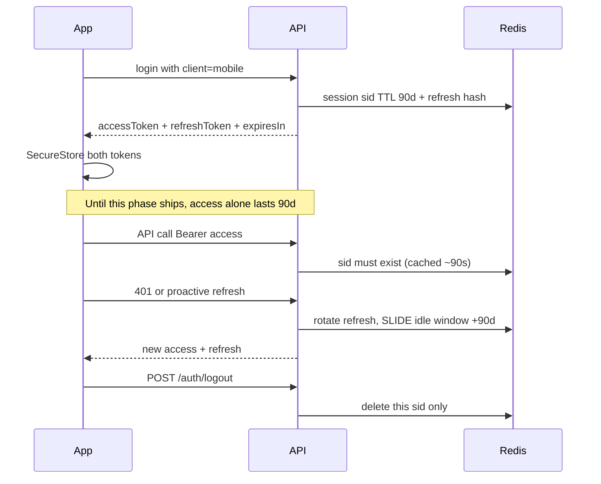

# Phase 12 — Session hardening (Redis sessions + refresh)

## Objective
Make mobile sessions Instagram/WhatsApp-style: **stay signed in across launches**, **independent of web**, with **rotating refresh** and **server-side revoke on logout**.

Backend + web already support this. This phase wires the native client.

## How mobile sessions work (API contract today)

| Concern | Behavior |
| --- | --- |
| Login | Always send `client: 'mobile'` (OTP + Google). `POST /auth/google/mobile` already defaults to mobile |
| Access JWT | Today **90d** so pre-Phase-12 builds keep working. After this phase, prefer shortening to **1h** (constant `MOBILE_ACCESS_TTL_SEC` on API) once refresh is mandatory |
| Refresh | Opaque; stored hashed in Redis; **rotated** on every use |
| Idle window | **90d sliding** on each successful refresh — open the app at least once per 90 days → stay signed in |
| Web logout | Revokes **web `sid` only** — phone stays signed in |
| Mobile logout | `POST /auth/logout` → revoke this device only |
| Stolen refresh | Rotation + mismatch revoke; store refresh only in SecureStore |

## Prerequisites
- Phase 01 done.
- Backend live with refresh + sliding mobile sessions + logout.

## Source documents
`../authentication.md`, `../mobile-authentication.md`, backend `docs/REDIS.md` § Student sessions.

## Implementation tasks
1. SecureStore: `ezprep.auth.token` + `ezprep.auth.refresh`.
2. `signIn({ accessToken, refreshToken, expiresIn })`; restore both on launch.
3. HTTP client: single-flight `POST /auth/refresh` on 401; optionally refresh when access is within 24h of expiry.
4. All logins: `client: 'mobile'`.
5. Logout: best-effort `POST /auth/logout`, then clear SecureStore + Google `signOut()`.
6. Zod for `{ accessToken, refreshToken?, expiresIn?, user, isNewUser }`.
7. After refresh works on device: ask backend to lower `MOBILE_ACCESS_TTL_SEC` (e.g. 3600) for stronger security without changing the 90d idle window.
8. Update `../MOBILE_STATUS.md`.

## Acceptance criteria
- Kill/relaunch keeps the session.
- Web logout does not sign out mobile (and vice versa).
- Corrupted/expired access + valid refresh → silent refresh, no sign-in screen.
- Invalid refresh → sign-in with expiry message.
- Unused for 90+ days → must sign in again.

## Risks
Rooted-device SecureStore extraction — mitigated by refresh rotation and per-device revoke.

## Rollback
Feature-flag refresh; access-only 90d tokens remain valid until natural expiry.
